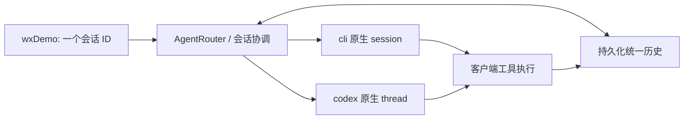

# 跨 Agent 共享会话技术方案

## 目标与范围

在 wxDemo 的同一条对话中切换 QwenCode（`cli`）和 Codex（`codex`），新 Agent 能接续此前用户需求、正式回复及实际工具执行记录；切回原 Agent 时补齐其离开期间的内容。现有流式显示与客户端工具链保持可用。

第一版实现 Gateway 单实例的持久化共享历史、同会话串行、按 Agent 差量上下文同步、客户端单一会话 ID，以及异常和重启后的重建。不会复制私有思考、迁移正在执行的任务或把历史工具调用重新执行。切换仍只允许在当前请求结束后进行。

## 现状与改造点

目前 wxDemo 为每个 Agent 保存不同的 CAP sessionId，Gateway 的 AgentSessionStore 又按 Agent 隔离原生会话。因此双方只记得自己的旧对话。改为一个 CAP 会话，下面保留多个 Agent 的原生运行会话；Gateway 的统一历史是事实来源，原生会话是续聊加速。

## 会话与持久化模型

- 会话归属：`clientId + endUserId + canonicalSessionId`。不同客户端和用户不能共享同名会话的数据。
- 一个公共 CAP sessionId；不同 Agent 的 CLI session/thread ID 仍各自独立，不能互换。
- 事件采用递增序号，记录 chatId、时间、类型、Agent、状态和内容；包含用户输入、完整正式回复、工具开始/成功/失败，以及请求错误或中断。不保存隐藏 thinking 为接手上下文。
- 工具事件记录 callId、工具名、参数和真实结果，区分已成功、已失败及结果未知，不能把计划写成已执行。
- 默认使用 `data/conversations` 下按作用域散列命名的版本化 JSON 文件。写入采用同目录临时文件与原子替换，数据目录加入 gitignore；不增加数据库服务依赖。读取损坏文件时明确失败，不静默当作空历史覆盖。
- 原生 Agent 引用和已同步游标作为进程内状态管理。重启、TTL 淘汰或运行会话失效后，以持久化历史重新建立原生会话；公共 sessionId 保持不变。第一版不承诺跨进程复用旧 CLI 线程，保证通过历史重建连续性。
- 新对话清空客户端公共 sessionId，下一次请求创建全新共享会话；不删除原有持久化记录。

## 单轮执行流程

1. 解析可用 Agent，生成/规范化公共 sessionId，立即以 SSE `session` 事件返回，避免首轮中断后客户端丢失会话身份。
2. 获取该公共会话的执行锁。同一会话跨 Agent 串行；不同会话可并行。
3. 快照此前历史，追加本轮原始用户输入和 running 状态并持久化。
4. 若目标 Agent 的原生会话仍有效，只补其游标后的历史；若没有原生会话则从完整共享历史重建上下文。当前用户输入只添加一次。
5. 将历史渲染为有明确边界的上下文数据块，与当前请求分开；适配器继续使用原有 CLI/MCP 调用方式。
6. delta/thinking 立即透传，不等待历史整轮完成；工具执行层在真实调用前后记录事件。
7. 成功时先持久化正式回复与 completed 状态，再推进该 Agent 的同步游标并发送 final。final 始终返回公共 sessionId。
8. 失败时保存错误和已有部分正文，标注不完整；不推进游标，并使目标 Agent 的运行会话失效，下一轮从共享历史恢复。不得自动重发可能有副作用的请求。

会话执行锁与历史短事务锁必须分离。模型执行期间可能在另一个 HTTP/WebSocket 线程回调工具；如果持有文件状态锁等待模型，会与工具记录形成死锁。文件操作只持有短锁，工具记录不获取整轮执行锁。

## 上下文补齐与长度预算

- 统一记录完整原文；发送给 Agent 的上下文受独立字符预算限制。
- 优先保留最近完整对话、当前需求和相关工具结果。较早内容使用明确标注的结构化节选，保留角色、来源 Agent、状态和序号；它是确定性的压缩，不冒充模型生成的语义摘要。
- 大型工具结果可在模型输入中截取首尾并标注省略，完整结果仍在持久化记录中。原文保存与本轮可见上下文不是同一概念，超出预算的细节不能承诺无损记忆。
- 历史只用于理解已有需求、约束和执行状态，不是本轮重新执行历史命令的授权。工具结果是数据，不应成为新的系统指令。
- 接手后涉及外部客户端状态的操作，应使用可用的只读工具确认当前状态，而不是假定旧快照仍然有效。

## 代码分层与接口

- `ConversationStore`：作用域隔离、事件持久化、快照、短事务以及每会话执行锁。
- `ConversationCoordinator`（或同等职责组件）：统一 sessionId、上下文渲染、原生会话有效性与同步游标、流式包装、成功/失败收尾。
- `AgentRouter`：同步和流式调用都经过协调器，避免同步请求绕过共享历史。
- `ClientRegistry.execute`：在实际客户端工具执行前后记录开始和结果；不重新调度历史事件。
- `ChatController`：使用规范化 sessionId，SSE 在模型输出前提供 `session` 元数据，保留原有 delta/thinking/final/error 协议。
- wxDemo `AgentClient`：只保存一个 sessionId，选择 Agent 时仅改变 agent 字段；接收 session 元数据，错误时保留会话身份。
- wxDemo `AgentPanel`：历史消息继续标注来源 Agent；文案改为“同一会话切换 Agent”，新对话重置整个共享会话；生成中仍禁用切换。

建议配置：`agent.conversation.directory`（默认 `data/conversations`）与 `agent.conversation.context-max-chars`（有合理最小值和默认预算）。启动脚本固定工作目录或使用绝对数据路径，避免重启时误读另一个目录。

## 验证与交付

自动化必须覆盖：A→B→A 差量补齐；同 Agent 连续请求无重复历史；首次 session 元数据；失败后保存历史且不复用受污染线程；重启/TTL 后重建；不同用户/客户端隔离；工具开始/成功/失败和未知状态；工具回调无死锁；长消息预算；坏文件保护；并发请求串行；重复终止事件不重复入账；旧流式显示与 Agent 切换禁用行为。

真实联调使用唯一临时只读客户端，完成 QwenCode→Codex→QwenCode，确认同一 sessionId、共享事实和已执行工具结果。再核对重建后的常规 wxDemo 输出，避免仅验证独立测试目录。不得修改用户画布来做验证。

## 实现状态

已实现：`core/conversation` 下的 `ConversationKey`、`ConversationStore`、`ConversationContextRenderer`、`ConversationCoordinator`；`AgentRouter` 的同步与流式入口都经过协调器；`ClientRegistry.execute` 在真实调用前后记录工具开始/结果；`ChatController` 在模型调用前发送 `session` 事件并规范化公共会话 ID；wxDemo 只保留一个 sessionId。

配置：`agent.conversation.directory`（默认 `data/conversations`）、`agent.conversation.context-max-chars`（默认 6000，下限 1000）。

已知取舍：每个 Agent 的同步游标与共享文档一起落盘，但原生会话引用只存在内存；重启后原生引用为空，协调器会按完整共享历史重建，因此游标不会导致漏掉上下文。工具事件统一标注来源 `client-tools`，因为 MCP 回调里没有"哪个模型发起"的字段。

自动化覆盖：切换接续与差量补齐、首次请求不包装、失败后失效原生会话、重启重建、客户端/用户隔离、工具记录与 running 状态、长历史预算与省略标注、损坏文件报错、同会话并发串行。真实 HTTP 联调由 `scripts/verify-codex-gateway.py` 与 wxDemo 真实网关测试覆盖。

联调结果：

- `scripts/verify-shared-history-rebuild.py` 通过。Gateway 重启后所有原生会话失效，真实 QwenCode 仅凭注入的共享历史答出了此前口令，`sessionId` 保持不变。
- wxDemo 真实网关测试通过：91 个增量，4145ms 正文可见，17027ms final；切换/会话断言全部通过。
- `scripts/verify-shared-conversation.py` 的前两轮成功，Codex 轮次被本机 `magpie` 提供方以 `429 Too Many Requests` 拒绝，未完成"QwenCode→Codex→QwenCode"的实机闭环。配额恢复后可直接重跑该脚本，无需改代码。

## 边界

第一版是单 Gateway 进程的本地持久化，不提供多实例共享目录协调、分布式事务或跨服务 exactly-once 工具执行保证。网络断线可能造成工具结果未知；记录这种不确定性并要求回读状态，不能自动认定成功或直接重试写操作。历史检索 UI、模型语义摘要和长期归档可在后续扩展。
