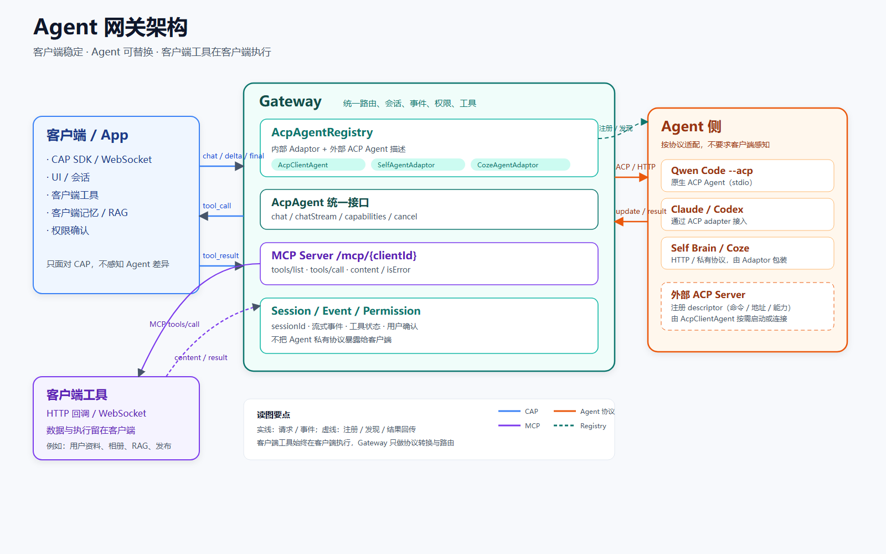

# Agent 网关架构设计

> 读者：客户端开发者 / Agent 接入方 / 项目维护者
> 目标：用一张图说明“客户端、网关、Agent、客户端工具”的关系
> 详细实现：[AcpAgent 架构改造技术方案](../agent/2026-10-27-14-acp-agent-architecture-plan.md)

## 一张图看懂



## 1. 三个角色

| 角色 | 负责什么 | 不负责什么 |
|---|---|---|
| **客户端 / App** | UI、会话、客户端工具、客户端记忆、权限确认 | 不实现 Agent，不感知 Agent 私有协议 |
| **Gateway** | 协议转换、Agent 路由、会话/事件、MCP 工具网关、权限透传 | 不执行客户端工具，不重写 Agent 能力 |
| **Agent** | 推理、规划、工具调用、Agent 内部上下文 | 不直接操作客户端私有数据 |

客户端工具始终在客户端执行；Gateway 只做协议转换和路由。

## 2. 两条链路

### 对话链路

```text
Client --CAP chat--> Gateway --AcpAgent--> Agent
Client <--delta/final-- Gateway <--事件----- Agent
```

- 客户端只面对 CAP；
- Gateway 把不同 Agent 的协议统一成客户端能消费的事件；
- 新增 Agent 只改 Gateway 的 Adaptor/Registry，不改客户端。

### 工具链路

```text
Agent --MCP tools/call--> Gateway /mcp/{clientId}
Gateway --tool_call--> Client（HTTP 回调 / WebSocket）
Client --tool_result--> Gateway
Gateway --MCP content--> Agent
```

- Agent 通过 MCP 发现和调用工具；
- 工具在客户端执行；
- Gateway 负责把 MCP 调用翻译成客户端能理解的 `tool_call`。

## 3. Agent 怎么接入

### 3.1 原生 ACP Agent

例如 Qwen Code：

```bash
qwen --acp
```

- 不需要写新的 Java 类；
- Gateway 用通用的 **AcpClientAgent** 接入；
- 在 **AcpAgentRegistry** 里登记命令/地址/能力；
- 同一个 AcpClientAgent 可以接所有 ACP Agent。

### 3.2 外部已经适配 ACP 的 Agent

例如 Claude Code / Codex 的 ACP adapter：

- 在 Registry 里登记 descriptor；
- Gateway 通过 AcpClientAgent 启动或连接；
- 不需要为每个 Agent 写适配代码。

### 3.3 项目内部 Agent

例如 Self Brain、Coze、非 ACP CLI：

- 写一个 **AgentAdaptor**，把私有协议翻译成统一接口；
- 适配完成后注册到 AcpAgentRegistry；
- 对客户端仍然表现为一个普通 Agent。

## 4. 关键设计

### 4.1 AcpAgent 是网关内部接口

`AcpAgent` 不是 ACP 线协议，而是 Gateway 内部的统一运行时接口。

```text
AcpAgent
├── AcpClientAgent      ACP Agent（通用）
├── SelfAgentAdaptor    内部 Brain
├── CozeAgentAdaptor    Coze
└── CliAgentAdaptor     非 ACP CLI
```

ACP 的 JSON-RPC 细节只存在于 `AcpClientAgent` 内部，不泄漏给客户端。

### 4.2 AcpAgentRegistry 管“有哪些 Agent”

Registry 存的是描述，不是进程：

- `agentId`；
- 来源：内部 / 外部；
- 协议：ACP / CLI / HTTP / Coze；
- 传输：stdio / WebSocket / HTTP；
- 命令或地址；
- 能力、认证、健康状态。

外部 Agent 注册必须管理员权限，并限制可执行命令，避免变成远程命令执行入口。

### 4.3 客户端不强制迁移 ACP

当前客户端使用 CAP；ACP 是可选方向：

- CAP 客户端继续可用；
- 原生 ACP 客户端未来可以通过 ACP 入口接入；
- 两者共享同一套 AcpAgent/Registry/工具链路。

## 5. 部署形态

| 形态 | 适用 | 注意 |
|---|---|---|
| 本地插件 | 桌面/开发工具 | Agent 也要在本地；App 不适合绑定多个 Agent |
| 远程服务 | App / 多租户 | Agent 在云端；客户端工具通过 WS/MCP 回调回本地 |
| 混合 | 本地 Agent + 远程 Gateway | 用本地 Connector 出站长连接，避免公网暴露 |

App 场景通常不是“把多个 Agent 装进 App”，而是：

```text
App（客户端工具 + 记忆） ↔ 远程 Gateway ↔ 远程 Agent
```

## 6. 这个架构解决了什么

- **复用 Agent**：不重写 Agent loop；
- **客户端稳定**：Agent 变化不穿透到客户端；
- **工具在客户端**：数据、登录态、相册、RAG 不离开客户端；
- **可扩展**：ACP Agent 注册即用，内部 Agent 用 Adaptor 补齐；
- **不强制统一**：ACP、CAP、MCP 各管一层，不混成一个协议。

## 7. 当前状态

- 客户端协议：CAP；
- 已内置：Self Brain、Coze、Qwen stream-json CLI；
- 已实现通用 `AcpClientAgent`，Qwen `--acp` 的文本/流式链路已跑通；
- MCP 客户端工具：Qwen 0.26 ACP 存在已知限制，工具不会进入模型工具表；当前客户端工具建议继续走 `cli`；
- AgentRouter 已实现；
- 外部 ACP Agent 注册已改为 WS-only：只登记 `wsUrl`，Gateway 不在本地启动 Agent；
- WS ACP 协议调用已实现，并用本地 Qwen Code 封装成 `AcpAgentServer` 完成端到端验证；
- `AcpAgentServer` 启动后会尝试自动注册到 Gateway，失败最多重试 3 次；
- ACP 客户端入口、管理员鉴权：后续阶段。

一句话总结：

> **客户端只面对一套协议，Agent 通过 Registry 接入，客户端工具通过 MCP 执行。**
